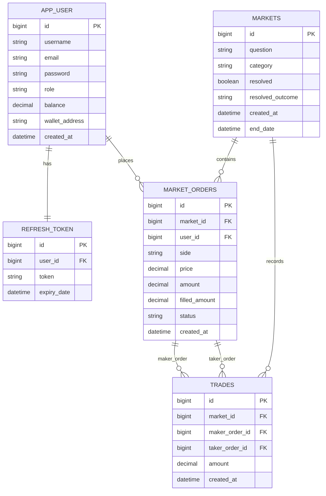

*This project has been created as part of the 42 curriculum by logkoege, lloginov, nippolit, djmarian, agrattep.*

# 42bet

## Description
42bet is a full-stack web application inspired by real-time prediction markets.
Users can register/login, place YES/NO market orders, track their portfolio and PnL,
receive real-time notifications, and manage their profile.

The project goal is to deliver a production-like collaborative web platform with:
- secure authentication and role-based permissions,
- real-time user updates,
- analytics and data visualization,
- scalable architecture with Dockerized deployment.

## Team Information

### Roles and Responsibilities
- djmarian: Product Owner + Developer
	- Product direction, feature prioritization, validation of delivered user-facing flows.
- lloginov: Project Manager + Developer
	- Sprint/task coordination, blockers follow-up, delivery tracking.
- agrattep: Technical Lead/Architect + Developer
	- Architecture decisions, backend/security critical reviews, module integration.
- logkoege: Developer
	- Feature implementation, frontend/backend integration, testing support.
- nippolit: Developer
	- Feature implementation, module completion, testing and QA support.

## Project Management
- Work organization:
	- Split into mandatory core + modules backlog.
	- Iterative implementation (auth -> markets -> admin -> analytics -> polish).
	- Peer reviews before merge for sensitive features (security, auth, role gates).
- Tools used:
	- GitHub Issues/Projects
	- Notion
- Communication channel:
	- Discord

## Technical Stack

### Frontend
- Angular 21 (standalone components)
- Angular SSR
- Tailwind + SCSS
- ngx-translate (i18n)

### Backend
- Spring Boot 3.5.x (Java 17)
- Spring Security + JWT
- OAuth2 client (42 and GitHub)
- Spring Data JPA
- Server-Sent Events (SSE) for real-time notifications

### Database
- PostgreSQL 15
- ORM: Hibernate / JPA (via Spring Data JPA)

### Infra / DevOps
- Docker Compose (single command deployment)
- Nginx reverse proxy (HTTPS termination)
- Health checks for services in compose

### Blockchain (project-specific integration)
- Solidity contract interaction from backend (Web3j)
- BSC testnet configuration via environment variables

### Why these choices
- Angular + Spring provide strong framework ecosystems and clear architecture.
- PostgreSQL offers relational integrity for users, orders, and analytics data.
- Docker Compose ensures reproducible local deployment for the whole team.
- SSE is lightweight and sufficient for event-style real-time notifications.

## Database Schema

Main entities and relations:
- app_user: user identities, roles, profile fields, balances, wallet address.
- refresh_token: one-to-one with app_user.
- markets: prediction markets metadata.
- market_orders: many-to-one with markets and app_user.
- trades: links maker/taker orders on a market.
- jwt_blacklist: invalidated JWT tokens.
- audit_log: security and activity logs.

## Features List

### Core Product Features
- Authentication and account lifecycle
	- Register, login, refresh, logout, email confirmation, reset password.
- OAuth2 login
	- 42 and GitHub providers.
- Prediction markets
	- Market listing, market detail, order book, YES/NO order placement, user order history.
- Real-time notifications
	- SSE ticket + stream, reconnect strategy, live notification dropdown.
- User profile
	- Profile data, wallet address save/update, role-aware UI.
- Admin panel
	- User CRUD, role management, market management and resolution.
- Search
	- Global search endpoint and frontend search UI.
- Contact and legal
	- Contact form + Privacy Policy + Terms of Service pages.
- Dashboard analytics
	- Portfolio value, PnL ranges, line/bar/pie visualizations, CSV/PDF export, custom filters.

### Team Contribution on Features
- Team-wide collaboration for all core features.
- Architecture and security-sensitive parts reviewed by agrattep.
- Product validation and prioritization handled by djmarian.
- Planning and delivery coordination handled by lloginov.
- Implementation and integration distributed across all developers.

### Feature Ownership Matrix
| Feature | Main Contributors |
| --- | --- |
| Authentication lifecycle (register/login/refresh/logout/reset) | agrattep, djmarian, lloginov |
| OAuth2 (42/GitHub) | agrattep, djmarian |
| Prediction markets + order workflow | logkoege, nippolit, agrattep |
| Real-time notifications (SSE) | agrattep, lloginov, logkoege |
| Admin panel (user CRUD + role controls) | djmarian, agrattep, nippolit |
| Dashboard analytics (PnL + charts + filters + export) | logkoege, nippolit, djmarian |
| Search and multilingual UX | lloginov, logkoege, nippolit |
| Legal/contact pages and integration | djmarian, lloginov |

## Modules

### Claimed Modules and Points
1. Major: Use a framework for both frontend and backend - 2 pts
2. Major: Implement real-time features using WebSockets or similar technology - 2 pts
3. Minor: Use an ORM for the database - 1 pt
4. Minor: Server-Side Rendering (SSR) - 1 pt
5. Minor: Custom-made design system (10+ reusable components) - 1 pt
6. Minor: Support for multiple languages (3 languages) - 1 pt
7. Minor: Support for additional browsers - 1 pt
8. Minor: Remote authentication with OAuth 2.0 - 1 pt
9. Major: Advanced permissions system - 2 pts
10. Minor: User activity analytics and insights dashboard - 1 pt
11. Major: Advanced analytics dashboard with data visualization - 2 pts
12. Major: Module of choice - Objective Prediction Market Engine Based on 42 Profile Data - 2 pts
13. Minor: Module of choice - 42 Community Profile Integration - 1 pt

Total claimed points: 18

Point calculation breakdown:
- Majors: 6 x 2 = 12 points
- Minors: 6 x 1 = 6 points
- Total: 12 + 6 = 18 points

### Module Compliance and Explanation (Evaluator-Oriented)
| Module | Pts | Why it is valid | How to demonstrate quickly | Contributors |
| --- | --- | --- | --- | --- |
| Major: Framework frontend + backend | 2 | Angular framework for frontend and Spring Boot framework for backend are used across all production routes/features. | Show Angular app routes and Spring controllers/services/repositories. | All team members (architecture led by agrattep). |
| Major: Real-time features (WebSockets or similar) | 2 | Implemented with SSE (similar real-time technology), including reconnect handling and multi-user event push. | Open two sessions, trigger order/market event, verify live notification propagation. | agrattep, lloginov, logkoege. |
| Minor: ORM for database | 1 | JPA/Hibernate entities, repositories, and relational mappings power all persistent models. | Show model classes + Spring Data repositories + DB updates after API actions. | agrattep, nippolit, djmarian. |
| Minor: SSR | 1 | Angular SSR build/runtime is configured and used. | Show Angular SSR config/build output and server entry. | logkoege, lloginov. |
| Minor: Custom design system (10+ components) | 1 | Shared UI component library created and integrated in multiple pages. | Show shared UI folder and reused components in contact/profile/admin/markets. | logkoege, nippolit, djmarian. |
| Minor: Multiple languages (>=3) | 1 | EN/FR/RU translations with language switcher and translatable UI text. | Switch language in UI and show translation files. | lloginov, logkoege, nippolit. |
| Minor: Additional browsers | 1 | Tested on Chromium + Firefox + WebKit with documented limitation for Safari-native device run. | Show test summary and run smoke scenario in at least two browsers. | djmarian, lloginov, logkoege. |
| Minor: OAuth2 | 1 | Remote authentication implemented with external providers (42 and GitHub). | Run OAuth flow and show account login/creation callback behavior. | agrattep, djmarian. |
| Major: Advanced permissions system | 2 | Role-based authorization, admin-only actions, and user management CRUD are enforced. | Login as USER vs ADMIN and show access differences + CRUD actions. | agrattep, djmarian, nippolit. |
| Minor: User activity analytics dashboard | 1 | User activity/portfolio insights provided via dashboard views and metrics. | Show positions/history, portfolio cards, and activity-derived values. | logkoege, nippolit, djmarian. |
| Major: Advanced analytics dashboard | 2 | Interactive line/bar/pie visualizations, live refresh, CSV/PDF export, custom range/filters. | Use filters/date range, trigger refresh, export CSV/PDF in dashboard UI. | logkoege, nippolit, djmarian. |
| Major: Module of choice - Objective Prediction Market Engine Based on 42 Profile Data | 2 | Automated generation/resolution engine uses real 42 progression signals and propagates outcomes through markets, balances, notifications, and analytics. | Show profile-signal based market generation/resolution path and downstream effects in UI. | agrattep, djmarian, lloginov, logkoege, nippolit. |
| Minor: Module of choice - 42 Community Profile Integration | 1 | Real 42 OAuth identities and profile signals are integrated into user context and used in community-facing UX. | Login via 42 OAuth, show real profile-linked fields and their usage in UI/feature flows. | agrattep, djmarian, lloginov, logkoege, nippolit. |

### Detailed Module Explanations

#### 1) Major - Framework for both frontend and backend (2 pts)
Requirement mapping:
- Frontend framework required: implemented with Angular 21.
- Backend framework required: implemented with Spring Boot 3.5.x.
- End-to-end usage required: all core features (auth, markets, admin, dashboard) are implemented through these frameworks.

#### 2) Major - Real-time features using WebSockets or similar technology (2 pts)
Requirement mapping:
- Real-time updates across clients: implemented via SSE notifications stream.
- Connection/disconnection handling: ticket-based stream auth + reconnect strategy.
- Efficient broadcasting: server pushes targeted notifications to subscribed users.

#### 3) Minor - ORM for database (1 pt)
Requirement mapping:
- ORM usage required: implemented with JPA/Hibernate through Spring Data JPA.
- Relational mappings required: entities include one-to-one and one-to-many mappings.

#### 4) Minor - Server-Side Rendering (SSR) (1 pt)
Requirement mapping:
- SSR required for performance/SEO: Angular SSR build/runtime is configured and used.

#### 5) Minor - Custom-made design system (1 pt)
Requirement mapping:
- Reusable components required: custom shared UI library includes 10+ reusable components.
- Coherent visual system required: reusable palette/typography/component styles are applied.

#### 6) Minor - Multiple languages (at least 3) (1 pt)
Requirement mapping:
- i18n system required: implemented with ngx-translate.
- At least 3 complete translations required: EN/FR/RU are provided.
- Language switcher required: UI language switch is available.

#### 7) Minor - Support for additional browsers (1 pt)
Requirement mapping:
- Support for at least 2 additional browsers required: validated on Firefox and WebKit in addition to Chromium.
- Test and fix requirement: smoke tests performed on core user flows.
- Browser limitations documented: Safari-native session limitation is explicitly listed.

#### 8) Minor - Remote authentication with OAuth 2.0 (1 pt)
Requirement mapping:
- OAuth2 authentication required: implemented with 42 and GitHub providers.

#### 9) Major - Advanced permissions system (2 pts)
Requirement mapping:
- User CRUD required: admin interface supports user operations.
- Roles management required: role-based model and restricted actions exist.
- Different actions by role required: user/admin access differs in routes and operations.

#### 10) Minor - User activity analytics and insights dashboard (1 pt)
Requirement mapping:
- Activity insights required: dashboard displays user positions/history and activity-derived indicators.

#### 11) Major - Advanced analytics dashboard with data visualization (2 pts)
Requirement mapping:
- Interactive charts required: line, bar, and pie visualizations are available.
- Real-time update required: dashboard refreshes periodically and reacts to notification-driven updates.
- Export required: CSV and PDF export actions are implemented.
- Custom date ranges and filters required: predefined ranges + custom date filters + side/status/category filters.

#### 12) Major - Module of choice: Objective Prediction Market Engine Based on 42 Profile Data (2 pts)
Requirement mapping:
- Custom major module required: this capability is outside predefined module list and is fully domain-specific to 42bet.
- Substantial technical complexity required: implemented across ingestion/normalization of 42 profile signals, deterministic market generation, objective resolution logic, and full-stack state propagation.
- Value and relevance required: directly improves market relevance, settlement quality, and user engagement in the prediction-market context.

What evaluator should verify:
- Show generation/resolution workflow tied to real 42 profile progression signals.
- Show resulting impact on market status, user balances/portfolio, notifications, and analytics views.

#### 13) Minor - Module of choice: 42 Community Profile Integration (1 pt)
Requirement mapping:
- Custom module relevance required: this module is directly tied to the 42 ecosystem and student interactions.
- Technical scope required for a minor module: implemented through real 42 OAuth identity linking, profile data mapping, and frontend usage of real profile context.
- Added value required: improves trust, authenticity, and onboarding quality by replacing generic identities with real 42-linked user context.

What evaluator should verify:
- Authenticate with 42 OAuth.
- Confirm real profile-linked information is attached to the local user context.
- Show this context being used in user-facing interaction flows.

### Module of Choice (Major - 2 pts)

#### Objective Prediction Market Engine Based on 42 Profile Data
This custom module introduces an automated market intelligence engine that creates and resolves prediction markets using real user progression signals from 42 data, with portfolio and token-side consequences inside 42bet.

##### Why we chose this module
Our core product is a prediction platform. We wanted markets to be generated from meaningful, measurable, real-world user progression instead of only manual admin input. This module makes the platform more relevant, dynamic, and aligned with our project identity.

##### Technical challenges addressed
- Data normalization challenge: converting heterogeneous 42 profile snapshots into stable, objective metrics usable by the market system.
- Deterministic market lifecycle challenge: mapping metrics to market templates, creating markets safely, and preventing duplicate/inconsistent market generation.
- Objective resolution challenge: resolving markets with reproducible rules from measurable outcomes rather than subjective decisions.
- Cross-domain consistency challenge: synchronizing backend generation/resolution logic with user balances, notifications, and frontend portfolio analytics.
- User control and safety challenge: integrating consent-based market generation and secure handling of user-linked profile context.

##### How it adds value to the project
- Produces context-aware markets with higher relevance for users.
- Reduces admin-only manual workload by automating market creation and resolution paths.
- Improves trust by using objective, auditable resolution criteria.
- Strengthens user engagement through a continuous loop: user progression -> market creation -> outcomes -> portfolio impact.
- Creates a richer ecosystem that combines prediction mechanics, analytics, notifications, and token economics.

##### Why this deserves Major status (2 points)
This module is not a small feature; it is a substantial system spanning data ingestion, metric extraction, market generation strategy, objective settlement logic, and full-stack propagation of outcomes. It introduces significant architectural complexity, domain-specific algorithms, and strong functional impact across multiple components of the platform. It is therefore clearly above Minor scope and qualifies as a Major custom module.

### Module of Choice (Minor - 1 pt)

#### 42 Community Profile Integration
This module integrates real 42 student identity signals into the user experience through OAuth-based profile linking and consistent profile-context usage in application flows.

##### Why we chose this module
Because the project targets the 42 community, we wanted users to interact in 42bet using authentic, 42-linked identities rather than isolated local-only profiles.

##### Technical challenges addressed
- External identity linking through 42 OAuth.
- Mapping external profile fields to local user records.
- Keeping frontend display and backend user context consistent after identity sync.

##### How it adds value to the project
- Improves authenticity and trust in interactions.
- Makes user context more relevant for community-centric features.
- Reduces friction during onboarding by reusing real profile information.

##### Why this fits Minor status (1 point)
It provides clear technical and product value, but remains narrower in scope than a full cross-domain major architecture. It is therefore intentionally claimed as a Minor custom module.

### Team Members per Module
- All modules were implemented collaboratively by the team.
- Focus ownership:
	- Product/module validation: djmarian
	- Planning and delivery management: lloginov
	- Technical architecture and critical review: agrattep
	- Feature implementation and integration: logkoege, nippolit, djmarian, lloginov, agrattep

### Browser Compatibility Notes (for module evidence)
| Browser Engine | Validation Status | Notes |
| --- | --- | --- |
| Chromium (Chrome/Edge family) | Validated | Main target environment, smoke-tested on core user flows. |
| Firefox | Validated | Smoke-tested on navigation, search, dashboard, responsive behavior. |
| WebKit | Validated | Engine-level smoke-tested as Safari proxy. |
| Safari (native macOS/iOS device) | Pending native session | Limitation explicitly documented; WebKit proxy validation available. |

## Individual Contributions

### djmarian (PO + Dev)
- Defined product priorities and acceptance criteria.
- Contributed to user-facing feature validation and implementation.

### lloginov (PM + Dev)
- Organized task progress and coordination.
- Contributed to implementation and stabilization.

### agrattep (Tech Lead + Dev)
- Led technical architecture and security-sensitive decisions.
- Reviewed and integrated complex backend/frontend module interactions.

### logkoege (Dev)
- Contributed to feature implementation and integration.
- Participated in testing and quality checks.

### nippolit (Dev)
- Contributed to feature implementation and module completion.
- Participated in validation and bug-fixing.

## Instructions

### Prerequisites
- Docker + Docker Compose
- Node.js 20+
- Java 17 (for local backend builds outside Docker)
- Maven (or use Maven wrapper)

### Environment setup
1. Copy environment template:
	 - cp .env.example .env
2. Fill required secrets in .env:
	 - JWT_SECRET
	 - Mail credentials
	 - OAuth client IDs/secrets
	 - Optional blockchain variables

### Run with one command (recommended)
1. docker compose up -d --build
2. Open the app through Nginx HTTPS (default):
	 - https://localhost:8443

### Useful service endpoints
- Frontend via Nginx: https://localhost:8443
- Backend health: http://localhost:8080/health

### Notes
- Credentials and secrets are never committed; use .env only.
- .env is gitignored, and .env.example is provided.

## Resources

### Technical References
- Angular documentation: https://angular.dev
- Spring Boot documentation: https://docs.spring.io/spring-boot
- Spring Security documentation: https://docs.spring.io/spring-security
- PostgreSQL documentation: https://www.postgresql.org/docs
- Docker documentation: https://docs.docker.com
- Server-Sent Events MDN: https://developer.mozilla.org/docs/Web/API/Server-sent_events
- OAuth2 RFC and practical docs: https://oauth.net/2

### AI Usage Disclosure
We used AI assistants (including GitHub Copilot and LLM-based chat tools) for:
- reducing repetitive coding tasks
- documentation text and text in general
- generating checklists

All AI-generated outputs were reviewed, edited, tested, and validated by team members.
No code was accepted without human understanding and peer verification.

## Known Limitations
- Safari native-device verification was not executed in this Linux validation session;
	WebKit engine tests were used as proxy coverage.
- Build tooling consistency depends on environment setup and package state;
	Dockerized run path is the reference execution mode.

## Privacy and Terms
- Privacy Policy and Terms of Service pages are integrated in the application and accessible from the UI.
